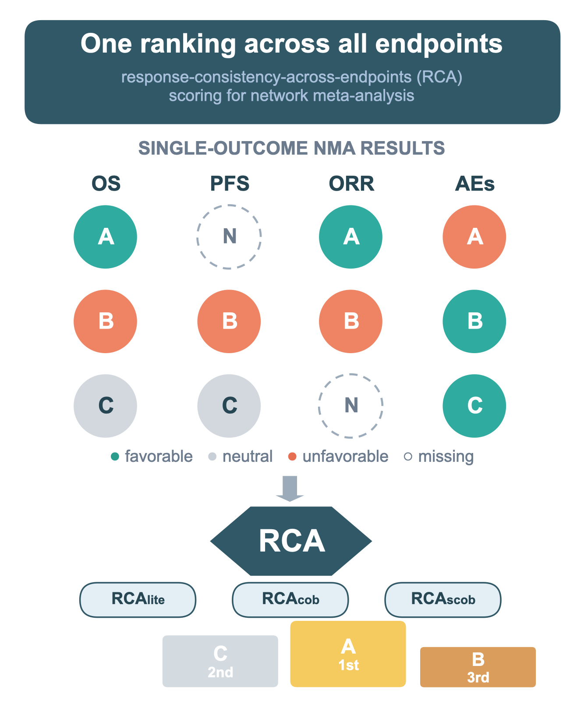

# RCA Score Calculator

Response-Consistency-Across-endpoints (RCA) scoring tools for network meta-analysis (NMA).

## What is this?

Network meta-analysis ranks interventions one outcome at a time. The RCA score family converts standard single-endpoint NMA results into **one overall cross-endpoint ranking**, so that interventions whose effects point consistently in favorable directions can be screened quickly and transparently.

Each endpoint is coded as:

| Code | Meaning |
|------|---------|
| +1 | favorable |
| 0 | neutral / unreported |
| −1 | unfavorable |

Three bounded scores are then computed for each intervention:

| Score | Definition | Range |
|-------|------------|-------|
| `RCA_lite` | directional net score: sum of directions | −n … +n |
| `RCA_cob` | concordance balance: (# of `++` pairs) − (# of `−−` pairs) | −C(n,2) … +C(n,2) |
| `RCA_scob` | strict concordance: `RCA_cob` − pairs containing any unfavorable direction | −C(n,2) … +C(n,2) |

Missing endpoints are handled by computing scores over available endpoints and standardizing to the full *n*-endpoint scale (asterisked scores). Final ranking uses **standardized `RCA_cob`**, with ties resolved by standardized `RCA_scob`, then `RCA_lite`.

## Two versions

| File | Direction coding rule | Use when |
|------|----------------------|----------|
| `RCA_tool_Effect.xlsx` | point estimate relative to the null | you want a summary of where the evidence points, keeping all interventions distinguishable |
| `RCA_tool_95CI.xlsx` | 95% CI must exclude the null before ±1 is assigned | you want to keep only "confident" directions; imprecise estimates drift to 0 |

Both files have identical structure. Running both on the same data is a useful sensitivity analysis: if the ranking changes between coding rules, report it.

## Quick start

No installation, no macros — just Microsoft Excel (2016 or later, or Microsoft 365).

1. **`1-Setup`** — define your comparator, the minimum number of endpoints required (m, default 2), up to **20 endpoints** (name, favorable direction, null value, optional weight, statistic) and up to **50 interventions**.
2. **`2-Input_NMA_Data`** — paste the effect estimate and 95% CI for every intervention × endpoint from your NMA.
3. **`3-Direction_Matrix`** — automatic. Codes each value to +1 / 0 / −1 according to your setup rules.
4. **`4-RCA_Results`** — read off `k_t`, `M_t`, all three raw and standardized scores, and the final rank.

## Weights (optional)

On `1-Setup`, **Apply weights?** is a Yes/No choice (default **No** = equal weights). Set it to **Yes** only if you want to use the Optional Weight column; authors choose the `w_i` values. Blank weights default to 1; negative weights are treated as 0. Weighted `RCA_lite` uses `w_i * d_i` and pairwise scores use `w_i * w_j`. Standardized pairwise scores are multiplied by `W / S_t`. With Apply weights? = No, results match the unweighted scores even if the weight column has been filled.

## Worked example (from the paper)

Three hypothetical interventions (A–C) versus a common comparator; lower is favorable for OS/PFS/AEs, higher for ORR:

| | OS (HR) | PFS (HR) | ORR (OR) | AEs (OR) | RCA_lite | RCA_cob | RCA_scob | RCA_cob* | Rank |
|--|---------|----------|----------|----------|----------|---------|----------|----------|------|
| A | 0.47 | NA | 2.70 | 1.23 | 1 | 1 | −1 | 2 | **1** |
| C | 1.00 | 1.00 | NA | 0.36 | 1 | 0 | 0 | 0 | **2** |
| B | 1.13 | 1.19 | 0.54 | 0.63 | −2 | −3 | −6 | −3 | **3** |

(Directions coded from point estimates; `*` = standardized to the 4-endpoint scale.)

## Limitations (v1.1)

1. RCA discards effect-size magnitude in its simplest form.
2. Results depend on prespecified coding rules.
3. Rankings may be unstable when few endpoints are available.
4. Weighting is optional: set Apply weights? to Yes to use author-specified w_i, or leave it as No for equal weights.
5. RCA is a **first-line screening tool**, not a definitive treatment ranking.

## Citation

> Liu Y, Song Y, Du Y, Qin C, Xu T. Response-consistency-across-endpoints (RCA) scores: a parsimonious approach to multi-outcome treatment ranking in network meta-analysis. *Medicine Advances* (in press, 2026).

If you use the tool, please also cite the version:

> RCA Score Calculator v1.0 (2026). https://github.com/Liuyanggggg/RCA-score-calculator

## License

MIT — see [LICENSE](LICENSE).
